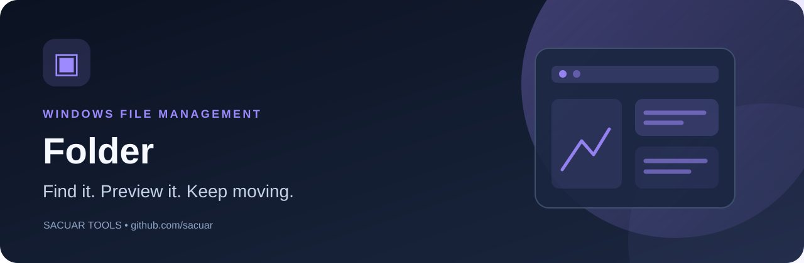

# Folder

**A customisable Windows file manager with tabs, previews, and tools for everyday file work.**

  

**[DOWNLOAD / RELEASES](https://github.com/sacuar/folder/releases)** · **[VIEW SOURCE](https://github.com/sacuar/folder)** · [More SACUAR apps](https://github.com/sacuar)

## Why use Folder?

- Navigate with tabs, a folder tree, multiple view modes and a configurable toolbar.
- Preview supported files including images, PDFs and selected document types.
- Explore optional local add-ons, search integration, and file-management tools.

## Ubuntu build

**Ubuntu 24.04 x64 (preview):** Native `.deb` packaging, tabbed browsing, file previews, directory-based search and Linux file properties are implemented. Windows Everything indexing and registry integration are not used on Ubuntu. [Ubuntu installation and limitations](packaging/linux/README.md) · [Ubuntu workflow](https://github.com/sacuar/folder/actions/workflows/ubuntu-build.yml).

## Install / try

Open **[GitHub Releases](https://github.com/sacuar/folder/releases)**, choose the latest suitable Windows asset, review its release notes and known limitations, and follow the installer instructions. If no verified installer is available, use the documented source-build instructions below. Download only from the official project release page.

**Release note:** Windows is the primary platform. Installer/build status and supported features depend on the published release. Linux support remains experimental; no default shell replacement is implied.

**Licence:** [MIT](LICENSE). Add-ons and bundled dependencies may have separate licences.

## Screenshots and first look

### Play video directly inside Folder

**Browse files and preview video without opening a separate media player.** Folder's integrated LibVLC preview provides **Play / Pause, volume, mute, scrubbing, and playback time**, right beside the folder contents. On Windows the installer bundles LibVLC; on Ubuntu the system LibVLC runtime is required. Playback depends on the installed codecs and desktop environment.

*Actual application capture generated from synthetic local sample files during the Windows build. This workspace capture shows the interface; it does not claim to depict active video playback.*

### Customise your workflow

| Add-ons | Folder options |
|:---:|:---:|
|  |  |

*Actual application dialogs from the Windows screenshot-generation step.*

> **Video-preview demonstration:** Select a supported video file (for example, MP4) with the preview pane enabled. Folder opens its built-in player and exposes playback controls directly in the preview area. A verified, playing-video screenshot is still being prepared; promotional artwork is not presented as a real screen capture.

## Get involved

[Changes](CHANGELOG.md) · [Add-ons](docs/ADDONS.md) · [Contribute](CONTRIBUTING.md) · [Report a bug](https://github.com/sacuar/folder/issues/new). Please report your Windows version, application version and steps to reproduce. Screenshots of reproducible issues help.

---

## Detailed documentation

## Available add-ons and built-in providers
| Provider | Availability |
|---|---|
| LibVLC video and audio | Bundled with Windows installer |
| PNG, JPG, SVG preview | Built in |
| PDF preview and thumbnails | Built in |
| DOCX text and tables | Built in |
| ZIP/TAR extraction | Built in |
| Thumbnail engine | Built in |
| STL preview and video thumbnails | Built in |
| Everything search | Built-in bridge; official Everything + ES required |
| Quick Photo Viewer | Separate installation, detected automatically |
| Trusted Python extensions | Local add-on directory |

The toolbar **Add-ons** button opens the plugin manager. Built-in providers are modular source components, not independently updatable binaries.

## Install
Download the x64 Setup EXE from Releases once the build succeeds. Python is not required. Unsigned alpha installers may trigger SmartScreen. Use Help → Check for updates to see release notes and install verified updates.

## Development
Python 3.12, PySide6, PyInstaller, Inno Setup 6. Use BUILD_INSTALLER.bat. Windows first; Linux remains experimental. See CONTRIBUTING.md, SECURITY.md and THIRD_PARTY_NOTICES.md. MIT license for Folder; dependencies have separate licenses.

## Roadmap
Native COM preview handlers, DOC rendering, video thumbnails, RAR/7z extraction, isolated and independently updated extensions, optional reversible default folder handler, and Microsoft Store packaging. No affiliation with Files Community.

## 0.6.0 Windows workspace
Folder Options includes thumbnail controls, hidden files, click mode, configurable New and context menus, sidebar shortcuts, cache reset and remembered applications. STL preview and video frame thumbnail generation are separate built-in providers. Cloud/email entries are browser bookmarks or user-selected local sync folders, not account connectors. Safe removal opens the Windows hardware dialog. Windows default apps remain user-controlled. Installer supports optional UAC elevation; Folder normally runs unprivileged. Native shell extensions are not registered by this release.

## 0.7.0 workspace
Responsive image/SVG previews, clipped folders and websites, cached website favicons, individually hideable cloud/email shortcuts, simplified appearance, compact Everything search, and Tools for file counts, drive usage, duplicate reports, cache clearing and Windows settings. Screenshot capture is removed from the active interface. Windows runtime verification is required.

## 0.7.1 compact search workspace
Icon-only toolbar and three-dot menu by default; restore labels and menus in Folder Options. View sizes and preview buttons use icons. Clip/Unclip is available in the folder tree and address toolbar. Bundled portable Everything and ES run on demand; full NTFS indexing may require administrator-approved Everything service. Wikipedia article excerpts appear inside a closable dialog; Google, ChatGPT and DeepSeek open externally. Yahoo Mail and website favicons use local cache. No private files are sent to web search.

### Installation maintenance
From Setup or Tools → Review old installations, scan old builds and startup entries, review exact paths, and use Windows uninstallers. No automatic folder deletion or registry sweeping. Folder 0.7.2 also defers selection preview rendering and avoids thumbnail generation in Details mode.

### Customisable toolbar (0.7.3)
New folder and New file appear first by default; the plus button sits at the right of the tabs. Right-click the command toolbar → **Customise toolbar**, or open Folder Options → Toolbar. Drag commands to reorder, uncheck to hide them, move Flexible space to align the remaining commands to the opposite side, choose top or bottom, and choose the position of the New tab button. Settings persist; Ctrl+T remains available even when the New tab button is hidden. Restore default layout if needed. The three-dot application menu remains available when the full menu bar is hidden.

### Old Build Manager
Tools → Old Build Manager: select an app or enter a similar name; scan common locations, fixed drives or a specific folder. Results include exact paths, old executables, installers, recognised runtime directories and registry references. Nothing is automatically selected or deleted. Protected installations and source directories are review-only; use Windows uninstall or open their location. Selected eligible builds can be recycled, with a final review. Export CSV for further inspection. Scans are bounded and cancellable.
